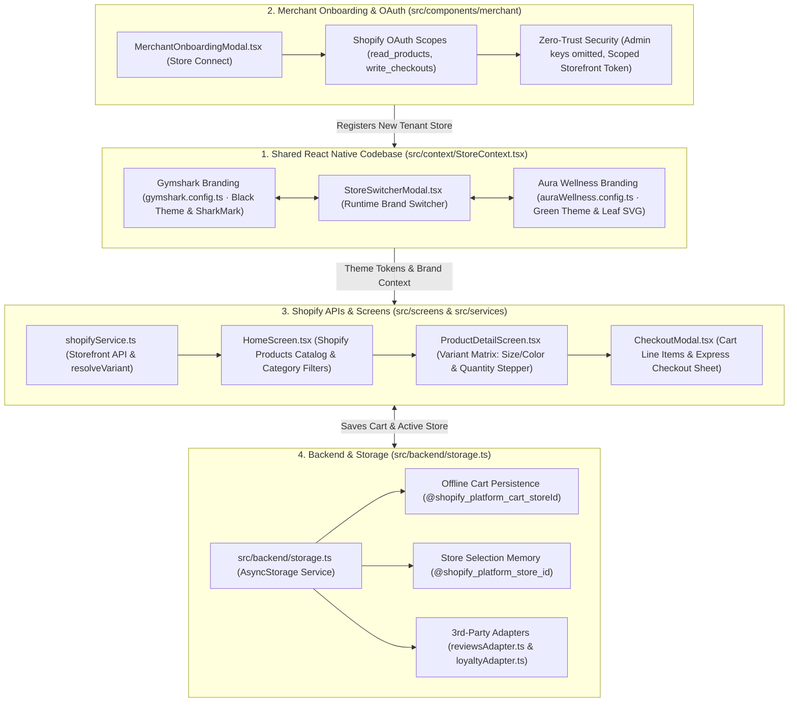

# Architecture & Integration Plan: White-Label Shopify to Mobile App Platform

## Executive Summary
This document outlines the architecture, integration patterns, and third-party ecosystem compatibility strategy for converting independent Shopify storefronts into branded, production-grade iOS and Android mobile apps using a single, reusable React Native platform.

---

## 1. High-Level Architecture Diagram

> **Visual Diagram Image:** [architecture_diagram.png](file:///Users/macbookpro/Desktop/shopify_Assesment/architecture_diagram.png) · [architecture_diagram.svg](file:///Users/macbookpro/Desktop/shopify_Assesment/architecture_diagram.svg)

---

## 2. Short Explanation Covering the 5 Core Points

### Point 1: Shared React Native Codebase with Store-Specific Branding and Configuration
* **Single Source of Truth:** A single, clean React Native codebase powers all merchant apps without maintaining separate forks or duplicate UI screens.
* **Dynamic Design Tokens (`TenantConfig`):** Store-specific styling (Gymshark's high-contrast athletic monochrome vs. Aura Wellness's warm sage green) is injected dynamically at runtime via `StoreContext.tsx`. Tokens control primary/secondary colors, border radiuses, button heights, typography scales, and SVGs (`SharkMarkIcon` vs `BotanicalLeafIcon`).
* **Feature Flags:** Capabilities like reviews, loyalty rewards, and promo hero banners are toggled on or off per store via simple configuration booleans (`features.showReviews`, `features.showLoyaltyRewards`) without modifying component code.

### Point 2: Merchant Onboarding, Shopify Authorization, and Secure Credential Handling
* **Automated Onboarding Flow:** Merchants connect their store through a standardized Shopify Partner App OAuth 2.0 PKCE handshake (`MerchantOnboardingModal.tsx`), granting only the minimum necessary public scopes (`unauthenticated_read_product_listings`, `unauthenticated_write_checkouts`, `unauthenticated_write_customers`).
* **Zero-Trust Credential Security:** High-privilege Shopify Admin API secrets are **strictly omitted** from client-side code and mobile binaries to prevent reverse-engineering exploits.
* **Hardware-Backed Key Storage:** Client-side Storefront tokens and customer session tokens are stored using hardware-backed cryptographic vaults — **iOS Keychain** and **Android Keystore (EncryptedSharedPreferences)** via AES-256 encryption.

### Point 3: Shopify APIs for Products, Variants, Cart, Customer Accounts, and Checkout
* **Catalog & Variants (Storefront GraphQL API 2024-10+):** Products, media galleries, prices, and options are queried with paginated GraphQL queries. A device-side variant resolution matrix (`shopifyService.resolveVariant`) matches user-selected options (e.g. Size: M, Color: Onyx Black) instantly with zero network delay.
* **Modern Cart Management (Shopify Cart API):** Shopping bag operations run on the modern Storefront Cart API (`cartCreate`, `cartLinesAdd`, `cartLinesUpdate`), supporting multi-line discounts, buyer identity, and automatic currency conversion.
* **Frictionless Native Checkout:** Checkout launches via the official **Shopify Checkout Sheet Kit** (or secure authenticated webview). Cart buyer identity is passed seamlessly, enabling 1-tap **Shop Pay**, **Apple Pay**, and **Google Pay** without forcing repetitive user logins.

### Point 4: Backend, Caching, Synchronization, and Reusable Integration Adapters
* **Performance Caching (Backend & Local Storage):** High-traffic product queries are cached with a 5-minute TTL to shield Shopify API rate limits during flash drops. Local cart state persists offline via `@react-native-async-storage/async-storage` (`src/backend/storage.ts`).
* **Event-Driven Synchronization:** Real-time Shopify Admin Webhooks (`products/update`, `inventory_levels/update`) trigger instant cache purges, guaranteeing zero overselling on out-of-stock items.
* **Reusable Integration Adapters:** 3rd-party services implement decoupled adapter interfaces (`reviewsAdapter.ts`, `loyaltyAdapter.ts`). If a provider (e.g. Yotpo, Smile.io) experiences an outage, the app degrades gracefully by hiding the widget or displaying cached summaries rather than crashing the product page.

### Point 5: Building, Releasing, and Updating Separate Merchant Apps
* **Multi-Tenant Build Pipeline:** A unified continuous integration pipeline uses Android `productFlavors` (`gymsharkRelease`, `auraWellnessRelease`) and Xcode Build Schemes to compile distinct native binaries with unique Application IDs (`com.gymshark.app`, `com.aurawellness.app`), custom app icons, and independent signing certificates.
* **Instant Over-The-Air (OTA) Updates:** Non-native JavaScript logic, bug fixes, UI styling, and tenant configuration updates are deployed instantly to end-users via **CodePush / EAS Update** channels without waiting for Apple App Store or Google Play review. Native changes (new SDKs or permissions) follow standard App Store release tracks.

---

## 3. Configuration vs. Build vs. Custom Development Matrix

| Capability / Change | Configurable (Runtime / Dynamic) | Requires New Build (CI/CD) | Requires Custom Development |
| :--- | :---: | :---: | :---: |
| **Theme colors, typography, logos** | ✅ (Via remote CMS / Tenant Config) | ❌ | ❌ |
| **Product catalog & collections** | ✅ (Live Shopify Storefront API) | ❌ | ❌ |
| **Enable/disable 3rd-party features (Reviews, Loyalty)** | ✅ (Feature toggle flag) | ❌ | ❌ |
| **App Store Name, Bundle ID, App Icon** | ❌ | ✅ (App Store binary requirement) | ❌ |
| **Push Notification Credentials (APNs / FCM certs)** | ❌ | ✅ (Entitlements & provisioning) | ❌ |
| **New Native 3rd-Party SDK with C++/ObjC/Java bindings** | ❌ | ✅ (Linking native libraries) | ❌ |
| **Custom Bespoke Shopify App (Proprietary legacy app)** | ❌ | ❌ | ✅ (Reverse engineering API / Custom adapter) |
| **Custom 3D / AR product visualizer** | ❌ | ✅ (Native ARKit/ARCore code) | ✅ |

---

## 4. Third-Party Compatibility Research (10 Categories)

| Category / Provider | Recommended Approach | Fastest Implementation | Failure or Fallback | Documentation Link |
| :--- | :--- | :--- | :--- | :--- |
| **1. Reviews** *Judge.me* | Native UI via Judge.me REST / GraphQL APIs; fetch review badges & cards asynchronously. | Embed authenticated responsive Judge.me review widget inside a headless WebView modal. | **Fallback:** Hide review star widget gracefully; display "Reviews temporarily unavailable" without blocking checkout. | [Judge.me API Docs](https://judge.me/api/docs) |
| **2. Loyalty** *Smile.io* | Native points display & rewards redemption sheet using Smile.io Headless REST API. | Launch Smile's web customer rewards launcher directly in an in-app browser with customer token. | **Fallback:** Hide loyalty points widget; allow standard checkout without loyalty discount code. | [Smile.io API Docs](https://docs.smile.io/) |
| **3. Subscriptions** *Recharge* | ReCharge Headless Subscription API to fetch plans & push subscription line item properties to Shopify Cart. | Direct customer to web checkout with Recharge subscription checkout URL. | **Fallback:** Degrade to standard one-time purchase option on the product detail screen. | [Recharge Developer Docs](https://docs.rechargepayments.com/) |
| **4. Search** *Algolia* | Native `InstantSearch` React Native library with instant debounced type-ahead and faceted filters. | Shopify Storefront API native `predictiveSearch` query. | **Fallback:** Standard Shopify Storefront API text search query (`products(query: "...")`). | [Algolia React Native Guide](https://www.algolia.com/doc/guides/building-search-ui/what-is-instantsearch/react-native/) |
| **5. Discounts & Bundles** *Shopify Functions / Bold* | Native execution via Shopify Functions (evaluated automatically on Shopify Cart API backend). | Pass draft order / discount codes directly via Cart API `cartDiscountCodesUpdate`. | **Fallback:** Plain cart pricing without bundling; warn customer that bundle will apply at checkout. | [Shopify Functions Docs](https://shopify.dev/docs/apps/build/functions) |
| **6. Notifications** *OneSignal / Klaviyo* | Native OneSignal React Native SDK for APNs/FCM tokens, rich push, and automated cart abandonment triggers. | OneSignal Web Push / Klaviyo email triggers without in-app native notification hub. | **Fallback:** In-app static banner notifications fetched via BFF JSON endpoint. | [OneSignal React Native SDK](https://documentation.onesignal.com/docs/react-native-sdk-setup) |
| **7. Analytics** *Segment / GA4* | Segment React Native SDK (`@segment/analytics-react-native`) forwarding to Google Analytics 4, Mixpanel, and Meta Ads. | Direct Google Analytics Measurement Protocol HTTP tracking calls from JS layer. | **Fallback:** Buffer tracking events in local SQLite / AsyncStorage queue and retry upon network restoration. | [Segment React Native SDK](https://segment.com/docs/connections/sources/catalog/libraries/mobile/react-native/) |
| **8. Customer Support** *Gorgias* | Gorgias Mobile Chat SDK or Zendesk Chat SDK with pre-authenticated customer email & name. | Open pre-authenticated web chat URL inside an in-app bottom sheet WebView. | **Fallback:** Native `mailto:` link or inquiry form submitting to merchant support inbox. | [Gorgias Chat API Docs](https://developers.gorgias.com/) |
| **9. Order Tracking** *AfterShip* | Native order tracking timeline using AfterShip Tracking REST API v4. | Deep-link to merchant's branded AfterShip web tracking page (`{store}.aftership.com/{tracking_number}`). | **Fallback:** Display standard Shopify Storefront `customer.orders` fulfillment status and tracking URL link. | [AfterShip API Docs](https://developer.aftership.com/) |
| **10. Returns** *Loop Returns* | In-app WebView embedding Loop Returns authenticated portal with single sign-on order number and zip code. | Direct external link to merchant's Loop portal (`{store}.loopreturns.com`). | **Fallback:** Display support contact form requesting manual RMA / return assistance. | [Loop Returns API](https://docs.loopreturns.com/) |

### Categorization Legend:
- **Shopify-Native Support:** Discounts (Shopify Functions), Predictive Search (Storefront API), Orders (Storefront Customer API).
- **Reusable Provider Integrations:** Yotpo, Smile.io, Recharge, Algolia, OneSignal, Segment.
- **Web-based Fallbacks:** Loop Returns, Gorgias Webview, Shopify Web Checkout.
- **Unsupported Features:** Liquid script tags, DOM-injecting marketing popups (must be rebuilt or omitted).

---

## 5. Strategy for Unfamiliar Shopify Apps & Theme Customizations

When a merchant relies on an unfamiliar Shopify app or bespoke Liquid customization:
1. **Audit Data Surface:**
   - Check if the app writes structured data to **Shopify Metafields** (Product, Collection, Variant, or Shop level). If so, read those metafields natively via Storefront GraphQL with zero custom app code.
2. **Headless API Discovery:**
   - Verify if the app vendor provides an official headless REST/GraphQL API or public SDK.
3. **Progressive Degradation Waterfall:**
   - **Tier 1 (Native UI):** Read Metafield / API -> Render native React Native components.
   - **Tier 2 (Headless WebView Sheet):** Render an isolated, secured bottom sheet loading the app's web-based endpoint, passing session tokens via PostMessage or URL params.
   - **Tier 3 (Web Checkout Deferral):** If the app is a checkout modifier (e.g., custom gift wrap, upsell widget), let it trigger during the Shopify Checkout Sheet Kit flow rather than PDP.
   - **Tier 4 (Graceful Omission):** If the feature cannot run without direct browser DOM access (e.g., jQuery wheel-spinners), feature-flag it OFF for mobile and notify the merchant.

---

## 6. Three Biggest Technical Risks & Proposed Solutions

### Risk 1: Mobile Checkout Friction, Apple Pay & App Store Guideline 3.1.1
- **The Risk:** In-app purchases of physical goods are permitted via credit card / Apple Pay, but custom checkout flows risk breaking Shopify inventory reservations, tax calculations, dynamic currencies, fraud detection, and Apple/Google compliance.
- **The Solution:** Use **Shopify Checkout Sheet Kit** (the official native SDK). It runs Shopify's ultra-optimized web checkout inside a native sheet with pre-warmed cookies, hardware Apple Pay / Google Pay authentication, and zero manual customer login prompts.

### Risk 2: App Store Rejection for "Spam / Template" Apps (Apple Guideline 4.3)
- **The Risk:** Apple Guideline 4.3(a) strictly forbids uploading multiple cookie-cutter apps from a single developer account.
- **The Solution:**
  1. Each merchant must enroll in their own Apple Developer Program / Google Play Console and invite the agency/platform account.
  2. Implement distinct visual design systems (custom typography, layouts, unique media banners, distinct color tokens) so apps do not appear identical.
  3. Deploy automated Fastlane pipelines that sign each app with the merchant's dedicated team certificates.

### Risk 3: API Rate Limits & Stale Inventory under High Traffic
- **The Risk:** Shopify Storefront API enforces dynamic rate limiting based on cost and store tier. High-volume flash sales (e.g., Gymshark drops) can throttle the mobile app, showing outdated variant stock.
- **The Solution:**
  1. Implement an Edge BFF proxy with Redis caching for catalog reads.
  2. Inventory availability is checked lazily only at the PDP and Cart level, never in bulk on browse grids.
  3. Shopify Admin webhooks (`inventory_levels/update`) invalidate edge cache instantly upon stock depletion.

---

## 7. Recommended Framework, Libraries & Acceleration Tools

| Category | Recommended Choice | Rationale |
| :--- | :--- | :--- |
| **Framework** | **React Native (0.76+ with New Architecture) / Expo** | Unmatched developer velocity, cross-platform parity, active ecosystem, and EAS multi-target build support. |
| **Styling & Design System** | **Restyle (Shopify) or StyleSheet Tokens** | Type-safe design tokens, runtime theme switching, and minimal JS-to-native overhead. |
| **State Management** | **Zustand + React Query (TanStack)** | Lightweight, boilerplate-free state, optimal cache invalidation, and automatic background re-fetching. |
| **GraphQL Client** | **urql or TanStack Query + graphql-request** | Leaner bundle size than Apollo Client, ideal for mobile cold-start performance. |
| **Persistence** | **MMKV or AsyncStorage** | Instant synchronous read/write for persistent cart and tenant configuration. |
| **Checkout & Payments** | **@shopify/checkout-sheet-kit** | Official Shopify native checkout bridge with hardware Apple Pay / Google Pay support. |
| **CI/CD & Builds** | **Fastlane + GitHub Actions / EAS** | Automated flavor builds, credential provisioning, and continuous OTA delivery. |

